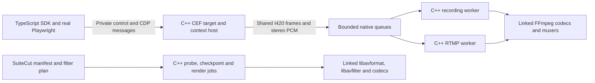

# SuiteCut C++ engine migration and validation — 2026-10-09

## Result and scope

**The native CEF/media backend is implemented and exercised end to end on Linux
x86-64.** CEF capture, pixel conversion, PCM timing, recording, RTMP publishing,
media probing, checkpoint decoding/encoding and presentation rendering now execute
in C++, using linked FFmpeg libraries. Native recording and publishing send no
raw pixels or PCM through Node and launch no FFmpeg subprocess.

The TypeScript layer owns commands, the real Playwright transport, SDK lifecycle,
manifest bookkeeping, presentation plans and user-supplied narration plugins.
It does not run a frame/audio scheduling loop or process raw media in the native
pipeline. The explicit older Playwright backend and low-level renderer without a
native source remain compatibility paths with their previous implementation.
The root renderer and CLI renderer use the native backend.

The final **30-minute simultaneous recording/RTMP run passes controller and full
decoded-media validation**. It completed 350 scroll events and a deliberate
four-second Node stall. Both outputs report zero audio queue drops and empty
queues after stop. The longest content hold is **0.50 s**, longest analyzed silence
**1.22 s**, and all six sync windows pass (maximum p95 **68 ms**).

Host CPU averaged **1.30 cores**, versus **3.03** in the saved OBS control
(**57.2% lower observed host CPU**). Capture paths, encoder settings and browser
versions differ, so this is a qualified workload comparison. Native media-core
sanitizers report no leaks/errors; the finite soak is not an indefinite leak proof.
The first failed native run and the near-29-minute interrupted run remain saved.

This implementation does not establish complete upstream Playwright compatibility,
absence of every possible leak, or performance superiority to OBS on every host.

## Native architecture

- `native/browser/browser.cc` hosts CEF targets/request contexts, routes private
  CDP, captures and converts frames, dispatches native outputs and file jobs, and
  handles dialogs, downloads, cookies and supported permissions.
- `media_engine.{h,cc}` implements an independent worker for each output, native
  CFR/audio clocks, bounded queues, encoders, muxing, finite I/O deadlines,
  pause/resume, failure reporting, finalization and queue cleanup.
- `media_file.{h,cc}` probes media directly and produces checkpoint clips with
  decoded frames, native scaling/encoding and final-frame padding.
- `media_render.{h,cc}` decodes inputs, connects libavfilter sources/sinks, splits
  reused inputs, applies the presentation graph, converts final cadence and
  encodes/muxes output. File rendering supports cancellation.
- `src/engine.ts` exposes `launchEngine`, genuine Playwright browser/context/page
  objects and native `record`, `stream`, `select`, `render`, status, pause and stop.
- `src/engine-test.ts` replaces Playwright Test's browser fixture with CEF.
  `suitecut/engine/test` supplies the ordinary runner, page/context fixtures and
  assertions. SuiteCut presentation recipes remain available through `recordNative`.
- Native recorder/publisher adapters contain lifecycle/control code. The old raw
  video writer, filesystem PCM spool, JS media callbacks and idle-frame timers
  were removed from those native adapters.

The C++ bridge implements browser context/target commands that CEF's page agent
cannot provide directly. It uses actual CEF/Chromium target IDs and forwards page
CDP. Cookie access uses each context's CEF cookie manager. Permissions use native
CEF content settings and permission callbacks; forwarding browser permission
commands through the page agent could not locate the native contexts reliably.

No OBS/libobs backend was imported. This is direct CEF plus FFmpeg. It is separate
from the missing OBS browser-source plugin on this host.

## Build and host

The host is Debian 13, Linux x86-64, with a four-core-equivalent cgroup CPU quota,
16 GiB memory limit, Xvfb and a PulseAudio 48 kHz stereo null sink. Graphics use
software rendering; there is no hardware encoder or texture-sharing implementation.
The coordinator owns an automatically selected private display, serializes runs
with `.suitecut/thread-control.lock`, checks dependencies and cleans up its children.

- CEF: **152.0.8+g1ce985c+chromium-152.0.7977.134**.
- Playwright / Playwright Test: **1.62.1**, using its public custom CDP transport.
- FFmpeg libraries: Debian **7.1.5-0+deb13u1**. Matching development packages for
  avcodec, avformat, avutil, avfilter, swscale and swresample were extracted into a
  private sysroot and linked to the host's matching runtime libraries.
- C++20, CMake/Ninja release build; Chromium sandbox remains enabled.

`build-metadata.json` saves exact binary/dependency hashes and host/version facts.
`development-packages.json` saves downloaded development-package SHA-256 hashes.
`tested-sources/` freezes the final implementation and configuration.
`tested-sources-interrupted/` preserves the earlier corrected-run snapshot.
Historical source/evidence snapshots are excluded from TypeScript and ESLint
project checking; standalone benchmark collectors run outside the typed SDK
project and are validated by execution and syntax checks.
Each soak saves `browser-tested`, the executable corresponding to that run.
The first soak's binary was copied from its running process's `/proc/.../exe`, so
later builds do not replace that executable evidence. Its evolving source was not
frozen at launch; the final source snapshot is not claimed to match that first binary.

The helper links external runtime libraries. A standalone distributable bundle,
macOS validation/signing and Windows support are not completed by this work.
See [ENGINE.md](../../../native/browser/ENGINE.md) for the build and API contract.

## Functional validation

| Check | Result | Saved evidence |
|---|---|---|
| Full TypeScript unit suite | 37 files, **306 tests passed** | `verification/all-unit-tests-final.log` |
| Native CTest | Media, audio clock and pixel conversion: **3 passed** | `verification/ctest.log` |
| TypeScript build and full type checking | Passed | `verification/ts-build.log`, `full-typecheck-final.log` |
| Full repository lint | Passed, historical snapshots and standalone benchmark collectors excluded | `verification/full-lint-final.log` |
| Real Playwright Test against CEF | **6 tests passed** | `playwright-complete.log`, `playwright-results.json` |
| Native browser diagnostic verifier | Passed | `native-browser.log` |
| Full native presentation integration | Passed | `presentation-visual-fixed/report.json`, `presentation-visual-fixed.log` |
| 1080p60 native RTMP verifier | Passed | `stream/report.json`, `stream.log` |
| Abrupt helper termination / fragmented MP4 recovery | Passed | `crash-recovery/report.json`, `crash-recovery.log` |
| Root CLI rendering through native C++ | Passed | `cli-render.log`, `cli-presentation.mp4.suitecut.json` |
| Native ASan/UBSan/LSan media-core exercise | Passed without reported errors/leaks | `sanitizers/build.log`, `run.log` |

The curated Playwright runner exercises locators/auto-waiting, click/fill/select,
scrolling, an iframe, screenshot, request routing, init scripts, local storage,
cookies before/after page creation, cookie isolation/clear, popups, dialogs,
uploads, an actual download, public CDP evaluate/detach, native recording, pause,
page switching, repeated context/page shutdown and geolocation grant/reset.

The recording test deliberately blocks Node for four seconds and requires native
frame progression, zero audio queue drops and empty queues after finalization.
The streaming verifier encoded **241 frames during its four-second Node block**,
measured about **60 fps delivered cadence**, switched pages inside one engine,
finalized queues, and observed startup failure against an unreachable RTMP endpoint.
Its external FFmpeg process only receives the native stream and validates media.
The receiver logs a terminal input/output error when the sender intentionally
closes the RTMP connection; native output status and decoded output are checked
separately from this expected receiver shutdown diagnostic.

The native browser diagnostic test additionally checks device scale, 3840×2160
capture, profile isolation, deliberate renderer crash and shutdown. That test opts
into raw diagnostic subscriptions; it does not represent the normal media path.

The presentation integration records two differently sized sources, verifies
native input, highlight/zoom/scroll actions, excludes delayed narration preparation
from capture, creates two native checkpoints, and renders through libavfilter at
960×540/60 fps. Decoded audio verifies source selection to 880 Hz and back to
660 Hz, an audible 440 Hz narration mix with page audio, and default audio disable.
Independent RGB samples also verify that video stays on the main blue page during
narration, switches to the green second page, and returns to blue. Callback failure,
cancellation and caller-owned source lifetime also pass.

The CLI separately renders the saved presentation manifest through the native
backend. FFmpeg executables remain available as independent verification tools;
those decode/probe commands are not SuiteCut's native rendering implementation.

## Issues discovered and corrected

1. Synthetic CEF target IDs broke Playwright frame attachment. The bridge now
   discovers and exposes genuine Chromium target IDs and defers page creation
   replies until discovery finishes.
2. Context shutdown mutated target maps while iterating them. Browser references
   are snapshotted for close operations, and child/session ownership is removed
   during native page shutdown.
3. Cookie commands routed to a page agent did not isolate native request contexts.
   They now use each CEF request context's cookie manager, including before pages exist.
4. Audio errors from a normally closing/inactive page could kill the entire host.
   Closing callbacks are ignored, active outputs receive explicit native failure,
   and inactive pages do not fail unrelated outputs.
5. CEF JSON integer and double accessors are distinct. Integer checkpoint duration
   300 was read as zero. Native numeric reads now accept both representations.
6. A trimmed filter input can end while other inputs/sinks still work. The native
   renderer handles that source EOF rather than treating it as a fatal feed error.
7. Presentation graphs can produce variable timestamps; FFmpeg CLI's `-r` had
   performed final cadence conversion. The direct renderer now has a native final
   fps filter and fills video packet duration, preventing duplicate DTS and an
   incorrect reported average rate.
8. Native adapter stop now rejects a mux/finalization error first reported at stop,
   even if periodic status polling had not observed it. Failure-path tests cover it.
9. Browser permission commands cannot find CEF's native context via the page agent.
   Native permission handling now honors context policies before page creation,
   applies them to navigated origins, and resets settings explicitly.
10. The initial native long run failed final sync. Unix audio PTS had been anchored
    to receipt time and subsequent deltas preserved. The clock now converts epoch
    PTS against a current wall/steady-clock pair, retaining a fallback for older
    monotonic PTS. Unit tests cover delayed packets and 400 ms of wall-clock slew.
    This improves timing robustness; the original end drift's sole cause is not
    established by the saved run, which lacks paired wall/steady samples.

11. A leading freeze segment in the shared presentation plan produced one frame
    instead of its requested duration in both native and CLI rendering. This advanced
    the visual page switch while audio retained the intended timing. A retained-frame
    loop now generates the entire hold. Native frame-count regression and independent
    decoded RGB checks verify the corrected timeline.
12. An environment restart interrupted an almost-complete long run before MP4
    finalization. Native MP4 capture now uses keyframe fragments and flushes its
    header and completed packets. The abrupt `SIGKILL` test verifies that completed
    fragments decode without errors and that the SDK reports the helper failure.
    The final unfinished fragment can still be lost; this is not fsync/power-loss proof.

Failed presentation and permission attempts are retained in the verification logs
and attempt directories. Temporary display-start failures were infrastructure
failures: an interrupted coordinator left a stale display lock. Automatic display
allocation and dependency readiness checks avoid reusing or deleting that lock.

## Long-run methodology

`soak.mjs` uses the same saved browser animation/scroll fixture as the OBS controls,
with a binary frame marker and a 250 ms flash/tone tied to the page's AudioContext.
It requests 1920×1080/30 fps and simultaneously produces H264/AAC MP4 recording and
H264/AAC RTMP received as FLV. Recording uses x264 veryfast/zerolatency CRF 18;
streaming uses x264 CBR 4500 kbit/s. Both native encoders use two threads.

Playwright sends alternating wheel commands approximately every five seconds.
At 40 seconds, Node is deliberately blocked for four seconds. C++ media workers
continue independently. No raw frame/audio subscribers are registered. Node memory
and CPU, native process CPU/RSS/thread/scheduling counters, host cgroup counters,
output counters and cleanup GC observations are saved independently.

For the corrected 30-minute run, compilation, other browser tests, media decoding,
sanitizer runs and competing encoders are completed before capture. Small control
reads/document writes remain possible. The first native long run and the corrected
short smoke overlapped implementation checks; their performance is qualified.
The build also copied CEF runtime files during the first run, so it is not a clean
comparison baseline.

Full-output validation decodes every marker and its actual presentation timestamp,
checks monotonic timestamps and content holds, and analyzes all audio using 20 ms
mono 8 kHz RMS blocks at threshold 0.015. Startup before three seconds and the final
five requested seconds are excluded consistently. Silence/content hold over five
seconds fails. Three 15-second sync windows per output require at least five pulse
matches and p95 absolute offset below 200 ms. This is a continuity threshold, not
a claim of zero repeated frames or zero audio imperfections. Periodic pulse
matching resolves offsets within half a second; it does not measure network
latency or disambiguate integer-second A/V shifts.

`result.json.status` checks native counters/lifecycle. `media-validation.json.status`
checks the decoded files as well. A run is only considered successful if both pass.
`findings.json` summarizes CPU/memory/continuity; raw samples and decoded artifacts
remain available so its calculations can be inspected.

## Preserved initial native 30-minute failure

| Measurement | Recording | RTMP receiver |
|---|---:|---:|
| Longest analyzed silence | 1.54 s | 1.52 s |
| Longest content hold | 0.667 s | 0.700 s |
| Distinct decoded frames per second | 25.846 | 27.898 |
| p95 sync at 5 s | 83.3 ms | 71.3 ms |
| p95 sync at 900 s | 119.7 ms | 126.7 ms |
| p95 sync at 1780 s | **346.7 ms — failed** | **489.3 ms — failed** |
| Native audio queue drop count | 0 | 0 |
| Final native queued media bytes | 0 | 0 |

The four-second Node block did not reproduce the old large transport-induced gaps.
Both outputs nevertheless fail the sync criterion at the end. Native counters
alone incorrectly suggest success; decoded validation is the decisive result.

The observed host average is 2.31 CPU cores, and Node averages approximately
0.62% of one core, but concurrent implementation work invalidates a clean speed
comparison. Node's cleanup GC leaves 278,927 bytes of ArrayBuffers and about
46.57 MiB used heap. Native RSS includes shared CEF mappings/caches and is not a
private-allocation leak measurement.

The corrected two-minute smoke passes all six sync windows: recording p95
60.0/27.3/36.7 ms, receiver 46.0/10.0/13.3 ms. Its longest silence is 1.26/1.24 s
and longest content hold 0.533/0.566 s. It also overlaps implementation checks and
cannot replace the corrected clean long run.

## Corrected 30-minute results

The `corrected-soak/` attempt was interrupted by an execution-environment restart
after roughly 28.8 active minutes. Its process and memory samples are retained with
`interruption.json`, but it did not complete shutdown or media validation. Its older
nonfragmented MP4 lacks the final `moov` atom. It is not a successful 30-minute test.

The final `final-soak/` run completed **1800.073 active seconds**, from
`2026-10-09T18:20:46.284Z` to `2026-10-09T18:50:46.916Z` including teardown. All 350
wheel commands were observed as 350 page scroll events. No compilation, other
browser tests, media decoding or competing encoders ran during capture.

| Measurement | Recording | RTMP receiver |
|---|---:|---:|
| Controller and decoded media | Passed | Passed |
| Native encoded frames | 54,015 | 54,006 |
| Distinct decoded frames per second | 28.284 | 28.789 |
| Longest analyzed silence | 1.22 s | 1.22 s |
| Longest content hold | 0.500 s | 0.500 s |
| Largest presentation timestamp gap | 54.688 ms | 34.000 ms |
| p95 sync at 5 s | 63.3 ms | 68.0 ms |
| p95 sync at 900 s | 50.0 ms | 48.0 ms |
| p95 sync at 1780 s | 20.7 ms | 14.0 ms |
| Native audio queue drops | 0 | 0 |
| Queued video/audio bytes after stop | 0 / 0 | 0 / 0 |

The paired wall/steady observations differ by only
**0.179 ms** over this run. This successful run does not
establish that wall-clock slew alone caused the preserved initial sync failure.

Host CPU averages **1.298 cores** over 1798.626 independently
profiled seconds. Node averages **0.572% of one CPU core**.
The main/utility CEF group averages 1.039 cores, CEF renderers
0.104, and the GPU process 0.106. Role grouping
includes shared CEF mappings; whole-host CPU also includes display/audio/control
and observer processes.

| Role RSS, shared mappings included | Minutes 3–8 median | Last 5 minutes median |
|---|---:|---:|
| node | 103.39 MiB | 109.58 MiB |
| suitecut-browser | 862.99 MiB | 860.59 MiB |
| cef-renderer | 271.21 MiB | 277.85 MiB |
| cef-gpu | 151.82 MiB | 154.30 MiB |

Node ArrayBuffers rise from a first-five-minute median of
**0.397 MiB** to **2.534 MiB** in the final five minutes.
After output/engine shutdown and explicit GC, **344,463 bytes
(0.329 MiB)** remain, with **49.46 MiB** used heap.
The uncollected control buffers during capture are visible in the plot and should
not be described as flat memory. Main/utility CEF RSS is slightly lower after
warm-up; renderer/GPU RSS increases by a few MiB and varies with scrolling.
These observations support bounded behavior over this run, not an unlimited
allocation-lifetime guarantee.

## Comparison with the saved OBS control

The previous OBS control used the same browser-flow fixture through external
Chromium/XSHM capture because this host lacks an OBS CEF browser-source plugin.
Its saved 30-minute recording had about 28.81 distinct fps, 1.10 s longest silence,
0.533 s longest content hold and six passing recording/receiver sync windows.
OBS reported 2,037 skipped rendering frames (3.77%), 70 global output/encoding
skips and zero stream-specific output skips. Those counters have different scopes.

The original SuiteCut failure retained 13.18 s silence and a content hold over
11 seconds. A controlled old reader-pause investigation demonstrated a C++ writer
blocked 4.145 s behind a raw video packet while CEF callbacks continued, overflowing
its PCM queue by 108 packets. The original natural stall's exact host/CEF trigger
was not established. See the preserved [dropout investigation](../../obs-cef/2026-10-09-dropout-investigation/report.md).

The observed final native host CPU is **57.2% lower** than this saved OBS
control. Native receiver cadence (28.79 distinct fps) is close to OBS
(28.81); native recording cadence is 28.28. Native maximum silence is
0.12 s longer, while maximum content hold is slightly shorter. No zero-repeat-frame
or image-quality-equivalence claim is made. OBS used four encoder threads per
output and normal stream B frames; native uses two and zerolatency/no B frames.
Full calculations and source observations are saved in `obs-comparison.json`.

Earlier SuiteCut CPU figures used VP9/Opus recording plus H264/AAC streaming; this
new primary soak records H264/AAC. Encoders, capture paths, run times and occasional
host competition differ. Do not attribute every CPU/FPS difference to language or
claim a direct OBS browser-source comparison. CEF page JavaScript remains Chromium
JavaScript; moving capture/media orchestration to C++ does not make page JS multithreaded.

The abrupt-stop test captured for 5.5 seconds and independently decoded **4.032
seconds** of completed MP4 fragments after killing the helper with `SIGKILL`.
The SDK reported the unexpected native exit. Header/packet flushing is necessary
even for low-motion video whose compressed fragments remain below AVIO buffer size.

## Memory and remaining limits

Native media buffers are shared immutable allocations. Each output bounds video
at 20 queued frames/64 MiB and audio at 500 packets/1.92 MiB. Overload replaces video
and explicitly counts discarded audio samples. Offline checkpoint input applies
backpressure. Stop/failure releases queues, frames, packets, codecs, scalers,
resamplers, muxers and filter graphs through worker shutdown/RAII.

The control protocol bounds commands, events/responses, UI command queues,
pending DevTools requests and writer queues. Output and file-job counts are bounded
per native target. The documented SDK stop/failure/abort paths and native media
failure/cancellation tests exercise cleanup.

ASan/UBSan/LSan cover SuiteCut's native media core and its offline/failure paths,
with no suppressions. They do not instrument prebuilt CEF/Chromium or every FFmpeg
allocation, and a finite soak does not prove indefinite stability or zero possible leaks.
RSS includes caches/shared pages; role sums double count shared mappings. Long-run
RSS observations and bounded buffers should be read alongside that limitation.

Native reconnect/adaptive bitrate, hardware encoding/texture sharing, Windows,
validated macOS packaging and the complete upstream Playwright suite are not
implemented or verified. Cross-process output switching is explicitly rejected;
use pages in one engine. Partitioned cookies are unsupported. Extra CDP sessions
share CEF agent domain state; full independent event/domain fidelity is unverified.
Tracing, service workers, cross-origin process frames and proxy/auth combinations
have not been certified by the curated runner. Unsupported permission names fail
explicitly; geolocation grant/reset is exercised.

## Evidence and reproduction

Use `../README.md` for executable commands and `build-metadata.json` for exact
versions/hashes. Preserved run media, independent receiver output,
decoded markers/audio/sync data, process/Node samples, native source snapshots,
binaries and validation logs are saved under this directory. The final archive
is `/workspace/shared/suitecut-native-engine-evidence-2026-10-09.tar.gz`.
Its archive SHA-256 is saved in the adjacent `.tar.gz.sha256` sidecar;
`checksums.sha256` inside the evidence covers the payload files. The archive
includes both source snapshots, exact tested binaries, raw profiler/Node samples,
media, decoded analysis, verifiers and reports. CEF SDK/runtime libraries are
identified by pins/hashes and are not duplicated into the archive.

The earlier optimization, OBS-long-control and dropout-investigation evidence
archives remain unchanged under `/workspace/shared/`.
