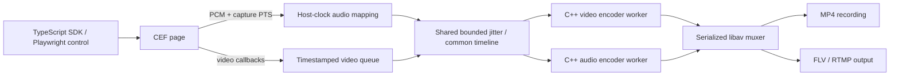

# Native A/V synchronization fixes and detailed capture evidence

Measured 2026-10-09 UTC; directory follows the prior reports' 2026-10-10 local-date convention.

## Outcome

SuiteCut already bundles video and audio in **MP4** for default recording and
**FLV** for RTMP publishing. MKV, MOV and WebM recording are also supported,
subject to codec compatibility. Changing container cannot recover missing CEF
samples or correct an incorrect capture clock. The fixes belong in the native
source/clock, buffering and encoding pipeline.

The latest native core passes its regression checks and has substantially better
short-run continuity after limiting realtime video encoders to one thread per
output. Remaining source gaps and stock CEF's cold first-sound loss are explicit
failures/limitations. This report does not claim uninterrupted capture, whole-CEF
leak freedom, full upstream Playwright compatibility, or superiority to OBS.

**The requested 30-minute run was interrupted by the execution tool being aborted
by the user at approximately 14.3 minutes. No completed 30-minute pass is claimed.**
The last native checkpoint was at 13.47 minutes, with zero late samples/overflow
and 7.109 seconds of uncovered input in both outputs. Earlier failures are retained.

## What changed

- Mandatory readiness initializes both native encoders, the muxer/header and
  first video frame. Silent pages receive timestamped zero PCM; sound emitted
  later stays on the same timeline. An AudioContext's `running` state and source
  audibility are not readiness conditions. The helper confirms
  `audioReadiness: 'engine'`; the SDK rejects older sound-gating helpers.
- Pinned CEF 154 emits **monotonic TimeTicks** audio PTS. Match it to the host's
  paired steady clock rather than anchoring it to receipt of the first callback.
  Epoch-based and unmatched-origin fallback support remains. Genuine source
  timestamp holes remain visible; there is no timestamp collapse or sample replay.
- Each output has independent audio and video encoding workers, its own codec
  context/frame/packet, and serialized libav muxer writes. One track cannot lead
  the other by more than 500 ms, bounding muxer backlog.
- Shared jitter starts at 150 ms and adapts up to 1000 ms when active-source audio
  has not arrived. `bufferedDelayMs` exposes the latency. A later source packet
  past an uncovered block confirms a hole; buffering cannot reconstruct it.
- Realtime video uses one encoder thread per output, including bounded HEVC/AV1
  parallelism. This reserves CPU for CEF rendering/audio on this four-core quota
  host. It is not a promise of realtime 4K60 on every supported codec.
- Stop retains input subscription until delayed audio through the original cutoff
  is drained, bounded by current jitter plus 200 ms. Pause drains its boundary
  before clearing input; fixed-frame codecs align to the next complete audio
  block. Resume excludes preparation time and explicitly refreshes a static page.
- A retained past video frame prevents a full queue of future frames from showing
  future content early. Video queue ownership is bounded at 64 frames / 768 MiB;
  audio is bounded at 500 packets / 1.92 MiB. Shared source pixels avoid a second
  copy per output. All queued ownership is released after stop.

No media travels through Node in this backend. TypeScript carries control/SDK and
Playwright messages; C++ links FFmpeg directly for encoding and muxing. The local
FFmpeg receiver and analysis processes are benchmark tools, outside production.

Each recording/stream has its own encoder pair and muxer; both subscribe to the
same immutable source buffers. Container timestamps describe that common media
timeline. The container neither initializes CEF audio nor supplies missing PCM.

## Source readiness still needs a custom CEF build

Stock CEF starts Alloy audio loopback capture only after a page becomes audible,
and stops it after two seconds of quiet. Initial sound can therefore occur before
capture is ready. The controlled cold-source matrix still measures roughly
351–984 ms to first native captured sound. Those intervals are preserved in the
file rather than trimming video or claiming early audibility proves readiness.

`native/browser/cef-patches/0001-persistent-audio-capture.patch` starts loopback at
browser creation when an audio handler exists and retains it through silence.
It applies cleanly to pinned CEF revision `14c5a08`; it is **not compiled, deployed,
or runtime verified**. The 32 GiB host filesystem cannot accommodate the full
Chromium source/build. The current stock distribution's checksum is unchanged.
A separate patched distribution must validate silent zero-PCM initialization,
first-sound preservation, quiet intervals, errors/restarts, contexts/popups and a
long dual-output run before SuiteCut can require source readiness at its handshake.

This source behavior is separate from the native encoders being ready. A muxer
cannot recover sound that occurred before CEF loopback captured it.

## Host, workload, and interpretation

Linux x64, CEF 154.0.34 / Chromium 154.0.8037.98; FFmpeg 7.1.5 libraries. CPU quota
is `400000 100000` (four CPU equivalents), memory limit 16 GiB. Rendering is
software on this host; GPU encoding is unverified. The macOS ARM64 CEF archive is
checksum-pinned but has not been built or run here. Exact pins, host versions,
helper/test binaries, source and compiled SDK are saved beside this report.

The soak requests 1920×1080 at 30 fps, H.264/AAC MP4 recording plus simultaneous
H.264/AAC RTMP into a local FLV receiver. The animated canvas contains a frame
marker. A 250 ms 440 Hz tone each second drives a visible pulse from the audio
context; the other 750 ms is intentional silence. Real Playwright wheel scrolling
runs every five seconds. At 40 seconds the Node controller blocks for four seconds
without consuming CPU (`Atomics.wait`), checking media independence from SDK control.

The original tone fixture schedules two seconds ahead on the page main thread.
A separate `SOAK_WORKLET_AUDIO=1` control generates the pulse from the audio sample
clock without that timer. It is labeled as a changed generator and is not pooled
with the original workload. Short controls and the long run are single trials;
there is no randomized repeated-trial performance claim.

Captures run serially with no compilation, tests, sanitizers or decoding in
parallel. Low-impact process samples include CPU, aggregate RSS, file descriptors,
thread count, scheduler pressure and cgroup throttling. Cgroup totals include the
profiled startup/teardown window; CPU-rate estimates can be skewed by delayed
sampling and are not exact attribution to a particular internal CEF task. Summed RSS includes shared
pages and is not private memory. Native audio tracing is opt-in and buffered to
local files; its overhead is part of these measured runs.

`analyze.py` decodes every video frame and all audio. Source PCM timestamps are
compared with each output's pre-encoder PCM/coverage. `droppedAudioSamples=0`
means no queue overflow; it does not establish continuous sound. `lateAudioSamples`
counts packets whose interval was encoded before they arrived. `missingAudioSamples`
counts zero-filled uncovered source frames, including legitimate silent pages
with no audio callbacks. Divide these 48 kHz frame counts by 48 for milliseconds.

Pulse timing uses 10 ms audio windows and 30 fps captured images; it is a coarse
content measurement. Nearest-neighbor timing percentiles are conditional on
matched pulses and can reuse a visible pulse. The final analyzer also records
unique bidirectional matches and unmatched pulses. Large held frames and source
silence must be assessed separately; a small matched percentile does not establish
clean global synchronization. Traces retain the raw inputs for other analyses.

## Regression verification

- Native CTest: five suites pass (media, silent startup/clock/drain/pause/future
  frame handling, codecs, audio clock, pixel conversion).
- SDK: 309 tests in 37 files pass; type checking and lint pass.
- Real CEF/Playwright: 11 tests pass. Coverage includes locators/auto-wait, keyboard
  and wheel scrolling, iframe/screenshot, silent/later-audio recording and streaming,
  mandatory protocol readiness, interception, init scripts, isolated storage,
  popup/dialog/upload/download, public CDP, blocked Node, pause/page switching,
  static-page preparation/resume, repeated shutdown, permissions/geolocation.
- All seven final integration media outputs decode without errors. The prepared
  static-page recording begins red and ends blue, confirming the refreshed frame.
- Final startup/media regression binary: **20 repeated ASAN/UBSAN cycles pass**
  with leak detection and halt-on-error enabled. Earlier passing cycles and
  failed fake-clock test attempts are retained; the latter were test ordering
  races corrected before the final repeats. Prebuilt CEF/Chromium and FFmpeg
  libraries are not sanitizer-instrumented. No indefinite leak guarantee follows.

## Preserved attempts and short controls

The first `pulsed-30min/` attempt was stopped early to fix native buffering after
fixed 150 ms jitter failed against 600–700 ms late callbacks. Last saved progress
was about 192 seconds; both outputs had roughly 181 seconds of late audio frames.
`result-before-interruption.json` preserves the original running-status bytes;
`interruption.json` states the reason and absence of final native statuses.
It is an interrupted failure, never a completed 30-minute pass.

`adaptive-pulsed-120s/` then reached zero late samples but still had 17.08 seconds
of decoded silence, 3.57 seconds of held video, a source stop/restart and substantial
CPU quota throttling. Adaptive buffering corrected lateness but not input supply.
These failures remain preserved; their lifecycle status `passed` only indicates
completion/finalization and assertions for queue overflow, not decoded quality.

After limiting encoder CPU parallelism, `budget-pulsed-120s/` recorded:

| Metric | MP4 recording | FLV receiver |
| --- | ---: | ---: |
| Late samples / queue overflow | 0 / 0 | 0 / 0 |
| Uncovered interior source | 120 ms | 120 ms |
| Source-to-output copied sample mismatch | 0 | 0 |
| Distinct images per second | 29.43 | 29.84 |
| Longest held image | 166.7 ms | 166.7 ms |
| Longest decoded silent interval | 880 ms | 890 ms |
| Matched pulse p95 absolute timing | 23.3 ms | 30.0 ms |

This control had zero quota-throttling events, two source holes (100 ms and 20 ms),
and maximum callback delay 137.6 ms. Expected pulse silence is 750 ms, so the
880/890 ms interval remains a continuity defect. Native aggregate mean CPU was
0.895 cores, peak summed RSS 1251 MiB. Start/end 30-second window RSS medians were
1170/1242 MiB; that short observation does not prove a steady-state plateau.

The `worklet-pulsed-60s/` control still had 14 incoming timestamp holes totaling
904 ms, maximum callback delay 552 ms, and 12 throttling events. Both outputs had
zero late samples/overflow and exact source copying, but approximately 1.1-second
silent intervals and a 466.7 ms held image. Missing source intervals therefore
also occur with sample-clock audio generation; the page's main-thread scheduler
is not the complete explanation. Changed generator and host scheduling variation
prevent treating this as an isolated randomized causal comparison.

Other short thread-split/cold-start cases, binaries and full traces are retained
in `pulsed-60s/`, `continuous-60s/`, and `startup/`. Those precede later clock,
buffering or encoder-budget fixes, as indicated by their saved tested binaries.

## Interrupted long-run metrics

The test requested 30 minutes but was interrupted at approximately 14.3 minutes.
Native final statuses, final queue cleanup, and trailer completion are unavailable.
The last checkpoint does not cover the final 49 seconds. Raw CSV/PCM files retain
their original bytes; `partial-analysis/` removes only incomplete trailing CSV
rows and records the normalization. The lifecycle CSV remained buffered and is
empty, so no source restart assertion is possible from that trace.

Every recoverable frame and all recoverable audio were decoded. Full decoder stderr
was checked separately because FFmpeg can exit zero despite a damaged packet.
The MP4 recovered cleanly. The FLV receiver has a truncated final H.264 packet;
its decode errors are saved in `logs/interrupted-flv-full-decode.log`. This is
an interrupted-file recovery result, not a clean received-output completion.

| Recovered content / bounded observation | MP4 recording | FLV receiver |
| --- | ---: | ---: |
| Decoded video frames | 25,680 | 25,518 |
| Recovered video duration | 856.0 s | 850.6 s |
| Distinct images per second | 29.54 | 28.01 |
| Longest held image | 1666.7 ms | 1700.0 ms |
| Longest decoded interior silence | 2130 ms | 2140 ms |
| Native late / overflow at last saved checkpoint | 0 / 0 | 0 / 0 |
| Traced uncovered interior source | 7,849 ms | 7,849 ms |
| Copied sample mismatches in complete-source range | 0 | 0 |
| Unique matched pulse p95 absolute timing | 83.3 ms | 93.3 ms |
| Unique matched / unmatched audio onsets | 846 / 39 | 840 / 44 |

**Continuity fails.** The 750 ms intended silence is extended to over two seconds
in both recovered outputs, and held images reach about 1.7 seconds. Conditional
pulse timing percentiles do not negate those failures. Some unmatched onsets are
fragmented tones; the receiver's last unmatched pulses also reflect its truncated
video tail. No final native counter claim is made beyond the saved checkpoint.

There are 100 complete incoming timestamp holes totaling
7849 ms, largest
680 ms. Maximum callback delay
is 1100.0 ms. Cgroup profiling records
56 throttled periods and
7.368 aggregate CPU seconds of throttling.
Scheduling bursts coincide with gaps, but this does not identify an exact
Chromium/PulseAudio internal root cause. These remain SuiteCut reliability issues
on this host, even where the data is absent upstream of the encoders.

The initial partial analyzer reported 7,636 receiver sample mismatches exclusively
in the unflushed source-CSV tail. `complete-source-copy-verification.json` records
their locations and limits comparison to complete source rows minus a 150 ms
boundary: 41,128,960 recording
frames and 41,115,648 stream
frames checked, with **zero mismatches**. Original trace bytes and the initial
validation are retained. This exclusion only limits trace comparison; it does not
remove decoded silence or held-image failures from the results.

Native mean CPU is 0.900 cores; peak summed RSS is
1285.7 MiB. First/last
214.4-second window medians are
1243.0 /
1276.4 MiB over
14.29 observed minutes. The roughly
33.4 MiB increase
is not proof of a leak or a steady-state plateau. Whole-CEF leak freedom, final
cleanup and completed 30-minute behavior remain unverified.

## OBS comparison and earlier evidence

OBS embeds CEF in its browser-source plugin; audio and video callbacks are separate.
Its mixer advances independently and emits silence for inactive sources. It uses
adaptive buffering and timestamp alignment, not a container to recover missing
source samples. The saved upstream-source review is in
`../../obs-cef/2026-10-10-audio-source-review/report.md`.

The installed OBS package on this host lacks the browser-source plugin. Its saved
comparisons capture external Chromium through XSHM. No new embedded-CEF OBS run
or universal performance advantage is claimed. Historical OBS and SuiteCut evidence,
including the original 13.18-second silence / >11-second video-gap failure,
remain unchanged. See `../../obs-cef/2026-10-09-optimization/report.md` and
`../../native-engine/2026-10-09/report.md` for those distinct pipelines and results.

## Saved files and reproduction

`commands.txt` contains build/test/capture/analyzer commands. `tested-sources/`
contains native and SDK code, tests, fixture and collectors; `tested-sdk/` contains
compiled SDK files. Top-level native binaries and each case's `browser-tested`
identify actual tested helpers. `build-metadata.json` pins dependencies/host and
`cef-source/source-urls.json` identifies reviewed upstream files. Raw PCM, source
and output CSV, decoded validations, media, CPU/memory samples, failures and all
logs remain beside the report. Checksum/archive verification is recorded after
finalization; the pinned full CEF SDK is represented by archive/library checksums
rather than duplicating its 1.3 GiB library into this evidence package.

The prior six sealed evidence directories were reverified: **3,653 files unchanged**.
The new portable archive is `/workspace/shared/suitecut-native-sync-evidence-2026-10-10.tar.gz`,
with SHA-256 and verification sidecars. `checksums.sha256` covers all new payload
files; `seal-verification.json` records local verification. The long run remains
explicitly interrupted and continuity-failed in the archive.
