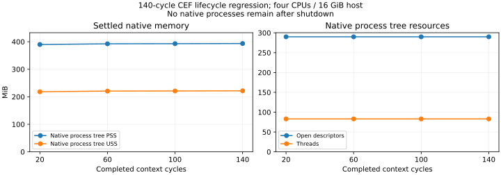

# SuiteCut 2.1: CHIPS, screenshot and CEF lifecycle fixes

Prepared 2026-10-11 from `25ff9b246f4502f96f8434f8cb690be1980aa043` on
`suitecut-2.1-compatibility-fixes`. The fallback branch remains at
`80759aeb30cc4f6bd4ab488554569c62851985d2`.

Partitioned cookies and the reproduced screenshot defects are fixed. Early popup
initialization, initial blank-origin `srcdoc` renderer crashes, and storage-access /
screen-wake-lock overrides remain unresolved. The investigation below separates
verified fixes from unsuccessful experiments and runtime limitations.

These are functional tests, not a new OBS performance comparison. Native runs use
CEF `152.0.6+g708dc14+chromium-152.0.7977.83`, codec-enabled Linux x64, and the
explicitly patched Playwright 1.62.1 driver. The control is stock Chromium
151.0.7922.34 with that same driver. CPU affinity is 0–3, the CPU cgroup quota is
four CPUs, and the host memory cgroup is 16 GiB. No new eight-GiB memory limit was
enforced. Version, source, binary and evidence hashes are in `metadata.json` and
`SHA256SUMS`.

## Retained fixes

### Partitioned cookies and page-less contexts

The previous `CefCookieManager` adapter dropped fields it could not represent and
rejected `partitionKey`. Browser-context `Storage` cookie commands now use
Chromium's page-scoped `Network` cookie commands in the correct CEF request
context. Chromium applies cookie validation, host/domain semantics, expiration,
SameSite and partitioning directly. A set operation still accepts at most 500
cookies.

A context with no user page temporarily gets a private 2×2 control page at one
frame per second. It is absent from public target and page lists and never feeds
media capture. It is retired once a user page can handle cookie commands. Requests
are bounded to 64 pending commands, 16 MiB total command bytes and a ten-second
deadline; closing the context cancels requests and closes the private browser.
Native shutdown waits for private browsers' close callbacks. Timeout checking
uses one scheduled pulse per agent rather than retaining one timer per command.

Regressions cover contexts both before and after page creation, context isolation,
partition-key round trips, filtered clears and authentication-state export/import.
A real cross-site HTTPS iframe receives only the cookie matching its top-level
partition. Repeated empty-context tests check that private target registrations do
not accumulate.

### Oversized element screenshots and capture isolation

CEF's pinned offscreen `RenderWidgetHostViewOSR::SetSize` implementation does
nothing; Chromium's screenshot resizing alone does not resize the CEF surface.
SuiteCut now temporarily resizes that surface via `WasResized`, with the correct
emulated device scale, and restores it when capture completes or fails. The CSS
viewport remains unchanged. Tests inspect pixel borders and sizes at DPR 1 and 2,
a 500×10,000 capture, and subsequent viewport captures.

Captures are serialized per native source, including independent CDP sessions.
There are at most eight queued captures, 4 KiB of arguments each, 8,294,400 physical
pixels per capture and 16,384 pixels per axis. Oversized requests return an
explicit error and leave the page usable. The upstream 32,767-pixel-tall image is
outside this resource policy. Full-resolution native media retains its existing
3840×2160 bound.

Temporary screenshot paint is excluded from the native media pipeline. The
encoder holds the previous video frame until normal paint resumes. A regression
records a red viewport while repeatedly capturing a blue offscreen region and
checks every decoded video sample: the recorded viewport stays red.

Two independent sessions capturing sequentially pass on both backends. A separate
native-only regression checks concurrent captures and viewport restoration. Stock
Chromium left the emulated viewport at a temporary screenshot height in the
original concurrent control, so that guarantee is not counted as shared upstream
compatibility. The failed control remains in the archive.

### JPEG background and oversized replies

SuiteCut's opaque-black default browser surface produced black JPEG backgrounds.
Root pages, newly created pages and popups now use Chromium's opaque-white default.
Upstream JPEG pixel checks pass; PNG and WebP explicit transparency still passes.

CEF DevTools replies above 16 MiB previously went unhandled, leaving commands and
potentially temporary screenshot state pending. They now emit an explicit source
failure and trigger the SDK's terminal-process cleanup. An isolated regression
requests a 17 MiB by-value evaluation, asserts the precise failure, and waits for
the native process and streams to close. This is a bounded failure policy, not
support for arbitrarily large CDP results or encoded screenshots.

## Final validation

| Check | Result |
| --- | --- |
| Focused CEF matrix | 53 passed, 0 failed, 0 skipped |
| Same matrix on stock Chromium | 49 passed, 0 failed, 4 skipped |
| Native media engine | 18 passed, 0 failed, 0 skipped |
| Selected upstream cookie/screenshot files | 130 passed, 0 failed, 1 skipped |
| Selected remaining CEF failures | 0 passed, 5 failed, 0 skipped |
| Same remaining cases on stock Chromium | 5 passed, 0 failed, 0 skipped |
| SDK delivery/native/connection unit tests | 41 passed |
| Native CTest groups | 9 passed |
| Native build, TypeScript, targeted ESLint and formatting | Passed |
| Seeded lifecycle workload on final helper | 140 cycles passed |

The saved stock matrix uses the same final compatibility test source. The added
oversized-reply check affects only the native-engine file. Final native tests and
lifecycle measurements use the final guarded helper, with frozen hashes recorded
before their run. Case-level outcomes are in `cases.csv` and `summary.json`.
Repeated runs and overlapping test files are not additional unique coverage.
No upstream test body was changed to obtain a pass. The upstream fixture supplies
SuiteCut's existing browser instead of launching stock Chromium; independent
browser-launching fixtures are explicitly unsupported by that harness. Its exact
fixture and configuration are saved with the tested sources.

The final cookie/screenshot run excludes three title patterns explicitly:

- `should isolate cookies between launches`: requires independent browser launch,
  outside this fixture. This is not evidence about cookie isolation between the
  supported CEF contexts, which has separate passing tests.
- `should work for webgl`: the default graphics path on this CPU-only Xvfb host
  cannot create WebGL; previous explicit SwiftShader tests are separate evidence.
- `should throw if screenshot size is too large`: this upstream case first
  captures a 32,767-pixel-tall image, outside the documented native resource bound.

The unfiltered exploratory run scheduled 134 cases and reported 128 passes, one
skip and five failures. Two JPEG failures were fixed and rechecked; the other
three correspond to the exclusions above. That run used the pre-white-default
helper and is archived as exploratory, not final release qualification.

## Remaining failures and attempted fixes

### Early popup initialization

The final selected failures reproduce user-agent inheritance and init-script
execution before a popup's first script. Other previously observed early console,
route, binding and dialog cases remain unestablished.

A browser-root remote-debugging-pipe experiment enabled `Target.setAutoAttach`
with `waitForDebuggerOnStart` before forwarding native readiness. It still failed
seven selected popup cases. A second experiment enabled/paused the child's
Debugger in `OnAfterCreated`, then resumed during Playwright initialization. It
passed two of seven cases but failed five: pausing after browser creation does not
reliably precede the first popup script. Both experiments were reverted. A proper
fix needs reliable attachment before the renderer's first script, rather than a
timing delay or a second debugger altering caller state.

### Initial blank-origin srcdoc crash

Creating `srcdoc` inside an HTTP-origin page works. Writing it into the initial
`about:blank` document crashes the CEF renderer. GDB records SIGTRAP in
`blink::DocumentLoader::CalculateOrigin`, with renderer termination status 2 and
exit code 5. The exact failing origin assertion/root cause has not been established.

This is reproduced by `cef-srcdoc-repro.cc`, a standalone program linking only CEF,
its wrapper and X11. It has no SuiteCut media engine, IPC, Playwright, DevTools
observer, context-policy overrides or automation flags. Both windowless and
windowed modes crash. Removing SuiteCut's request handler and using a minimal
client inside the bootstrap also did not fix it. The evidence establishes a
failure in this CEF build/runtime path independent of SuiteCut's adapter. It does
not prove every CEF version or platform is affected. A fix requires a CEF/runtime
change; disguising the document's origin would change browser security semantics.

The standalone source, build command and both crash logs are saved under
`standalone-cef/`. Downloaded pinned Chromium/CEF implementation excerpts and GDB
logs are in the archive for further diagnosis.

### Storage-access and screen-wake-lock overrides

CEF request contexts created via `CefRequestContext::CreateContext` are not
registered in Chromium's browser-domain DevTools context manager. Passing their
real GUID to `Browser.grantPermissions` returns `Failed to find browser context`.
Omitting the context ID makes the command succeed against the original global
profile while the isolated CEF page still reports `prompt`; grants also leak
between contexts in the experimental approach. Thus success would be false.

Page-domain forwarding and private-agent forwarding do not register those
contexts. Earlier wake-lock content-setting experiments also failed. The unsafe
permission-delegation code was reverted. Existing scoped permission mappings
retain their passing regressions; unsupported `storageAccess` and
`wakeLockScreen` still return explicit errors. Solving these overrides needs a
CEF-supported scoped permission hook or a backend change exposing these contexts
to browser-domain DevTools.

The same five selected remaining cases pass on stock Chromium with the same
pinned Playwright driver. They are confirmed CEF/SuiteCut-path failures on this
host, rather than failures shared by this stock-browser control.

## Lifecycle and memory profile

The seeded workload (`0x5eeda11`) runs 140 mixed cycles: create isolated context,
set/read/clear a partitioned cookie, optionally open a page, optionally capture an
oversized element, then close the context. Each cycle compares the public target
list with its initial baseline. After 20 warmup cycles, measurements follow three
additional blocks of 40 cycles. The final shutdown also closes a deliberately
unclosed context with an active private cookie agent. Node GC runs before settled
snapshots; native PSS/USS is collected with psutil. Raw sampled process data and
all per-cycle timings are preserved.

| Snapshot | Native processes | PSS MiB | USS MiB | Open FDs | Threads |
| --- | ---: | ---: | ---: | ---: | ---: |
| after-20 | 8 | 389.90 | 218.25 | 290 | 83 |
| after-60 | 8 | 392.44 | 220.70 | 290 | 83 |
| after-100 | 8 | 392.87 | 221.12 | 290 | 83 |
| after-140 | 8 | 393.43 | 221.68 | 290 | 83 |
| after-engine-close | 0 | 0.00 | 0.00 | 0 | 0 |



Native PSS increased 3.52 MiB between cycles 20 and 140, including 0.56 MiB
in the last 40-cycle block. Descriptor and thread counts stayed constant at
290 and 83. All native processes exited at final shutdown. These
measurements show small retained growth, not zero growth; allocation caching and
a small leak cannot be distinguished by this short run. RSS sums double-count
shared CEF pages, so PSS and USS are the primary figures. Node/controller memory
is preserved separately in the raw snapshots.

This short lifecycle test detects target/process/descriptor accumulation and
samples memory growth; it is not whole-CEF memory-safety certification. Native
ASan/LSan instrumentation was not enabled for this helper, and the prebuilt CEF
library is not instrumented. Existing sanitizer/media fuzz evidence remains
separate. Longer soaks, sanitizer-instrumented CEF/dependencies, and the full
upstream compatibility suite remain necessary before promising leak freedom or
complete Playwright compatibility.

## Evidence and reproduction

`evidence.tar.gz` contains final and exploratory logs, JSON test results,
artifacts, process samples, failed experiment sources and the standalone CEF
reproduction. Profiles/cache directories and runtime binaries are excluded.
`archive-manifest.json` and `SHA256SUMS` allow integrity checks. The archive labels
retain original directory names; only the sources in `tested-sources` are the
retained implementation. Experimental sources are not shipped code.

From the repository root, with the built native runtime and dependencies already
installed:

```bash
export pnpm_config_verify_deps_before_run=warn
export SUITECUT_RUNTIME_EXECUTABLE=/absolute/runtime/suitecut-browser
export COMPAT_BACKEND=cef
export COMPAT_DIRECTORY=/tmp/cef-compat
export MEMORY_DIRECTORY="$COMPAT_DIRECTORY"
taskset -c 0-3 python3 benchmarks/native-memory/runtime.py exec \
  pnpm exec playwright test --config benchmarks/playwright-compatibility/playwright.config.ts

export MEMORY_DIRECTORY=/tmp/native-engine
taskset -c 0-3 python3 benchmarks/native-memory/runtime.py playwright

export MEMORY_DIRECTORY=/tmp/cef-lifecycle
taskset -c 0-3 python3 benchmarks/native-memory/runtime.py exec node --expose-gc \
  benchmarks/playwright-compatibility/2026-10-11-final-bridge-fixes/lifecycle-profile.mjs
```

The helper in the shared evidence folder replaces the helper in an existing
compatible runtime bundle; it requires that bundle's CEF resources and native
libraries. It is not an independently installable runtime or a newly published
release. No tag, npm package or benchmark website was published by this change.
